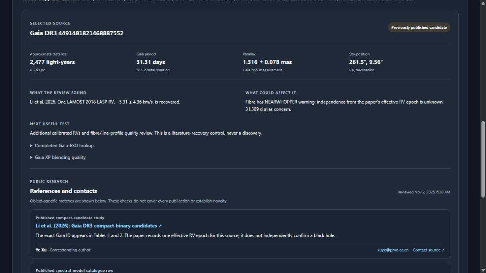

<p align="center">
  
</p>

<p align="center">
  <strong>An open research workspace for following up unusual Gaia measurements.</strong><br>
  Real observations, traceable evidence, and a clear line between an anomaly and a discovery.
</p>

<p align="center">
  
  
  
  
</p>

> [!IMPORTANT]
> **No previously unknown black hole has been confirmed or released by this project.** The objects shown here are held for scientific review. An unusual Gaia orbit can also result from an incorrect fit, blended light, a luminous companion, or a multiple-star system.

## The search at a glance

<table>
  <tr>
    <td align="center"><strong>500</strong><br>historical Gaia records</td>
    <td align="center"><strong>17</strong><br>threshold anomalies</td>
    <td align="center"><strong>14</strong><br>sources held for review</td>
    <td align="center"><strong>0</strong><br>new candidates released</td>
  </tr>
</table>

The numbers describe a **quality-selected, historical snapshot**, not a census of the sky. Of the 17 anomalies, 14 were held, two known black holes were excluded, and one previously refuted case was excluded. Within the 14 held sources, two were later identified as already-published **candidate controls**; the other 12 have unresolved novelty. These are distinct from the two known-black-hole exclusions. The source review is dated November 2, 2026.

## Explore the sources

The [interactive source explorer](dashboard/README.md) places the 14 held objects in an approximate Sun-centered 3D view. Select a point or search the list to inspect the measurement, known risks, next useful test, articles, and public professional contacts.

<p align="center">
  <a href="dashboard/README.md"></a>
</p>

<sub>The screenshot shows a dated snapshot. Distances use a simple inverse-parallax estimate; error bars, systematics, and a distance posterior are not shown. The display is not a complete sky search.</sub>

<p align="center">
  
</p>

### Examples from the review

| Gaia DR3 source | What the work found | What remains open |
| --- | --- | --- |
| [`4491401821468887552`](https://simbad.cds.unistra.fr/simbad/sim-id?Ident=Gaia+DR3+4491401821468887552) | Appears in [Li et al. 2026](https://arxiv.org/html/2610.34715v1) as a compact-binary candidate. One LAMOST radial-velocity measurement was recovered. | The paper has one effective RV epoch for this source; the independence and quality of the recovered measurement remain unresolved. This is a published-candidate control, not a new discovery. |
| [`1533365584518328576`](https://simbad.cds.unistra.fr/simbad/sim-id?Ident=Gaia+DR3+1533365584518328576) | A public LAMOST spectrum and later survey product were located. | Low signal-to-noise, source/fibre association, velocity frame, and calibration need further work; one spectrum does not establish an orbit. |
| [`2852726284550996352`](https://simbad.cds.unistra.fr/simbad/sim-id?Ident=Gaia+DR3+2852726284550996352) | Appears in a [published wide-pair catalog](https://cdsarc.cds.unistra.fr/viz-bin/cat/J/MNRAS/506/2269). | A likely wide stellar association does not establish an inner black-hole orbit or prove a triple system. |

See the [source-by-source review queue](real-data/studies/nature-goal-20261031T224551Z/continuation-20261102T1234Z-01a193cc/REVIEW_QUEUE_V9.md) and [public literature review](public-review/README.md) for the full evidence and limitations.

## Run the explorer

Install Node.js 22 or later, then:

```sh
cd dashboard
npm ci
npm run dev
```

Open the local URL printed by Vite. This portable explorer is **static**: it does not connect to the originating chat or display live agent activity. The [dashboard guide](dashboard/README.md) describes the data and controls.

## Reproduce the historical harness run

Use Python 3.11 or 3.12 and an isolated environment. From the repository root on Windows:

```powershell
py -3.11 -m venv .venv
.\.venv\Scripts\python.exe -m pip install -r real-data/harness/requirements.lock
.\.venv\Scripts\python.exe -m pip install --no-build-isolation --no-deps -e ./real-data/harness
Set-Location real-data/harness
..\..\.venv\Scripts\python.exe -m harness2.cli.universe verify
..\..\.venv\Scripts\python.exe -m unittest discover -s tests -v
..\..\.venv\Scripts\python.exe -m harness2.cli.universe run --output runs/my-first-real-run --cache data/my-first-cache --memory runs/my-first-memory.json --k 3 --mode sequential --provider deterministic --backend numpy
```

Use fresh output, cache, and memory paths for each run. On Unix, use `python3 -m venv .venv` and `.venv/bin/python`. The default run reads the bundled historical Gaia snapshot; it is not a live search. Live archive requests are explicit and may fail without falling back to cached or simulated records. See the [harness README](real-data/harness/README.md) before running them.

The approved harness guard verified and its suite ran 37 tests: 36 passed and one native Windows symlink-capability test was skipped because the OS denied symlink creation. A fresh CPU snapshot run reproduced the counts above. These are dated local verification results, not a claim about a future environment.

> [!CAUTION]
> **Holdout custody is unresolved.** Prior evaluation exposed snapshot test sources and the original consumed-source ledger is missing. Do not create an empty replacement ledger or run a new scientific holdout evaluation until custody is reconciled. Never automatically reseal a failed code guard.

## Check the public literature packet

From the repository root:

```sh
python -B public-review/verify_public_review.py
python -B verify_export.py
```

The first command rechecks exact string IDs against the included evidence; the second verifies the export's recorded file hashes. The literature comparisons are finite: a general search index missed known-positive controls, the complete Li 2026 table was unavailable, and the full 9.86 GB XP dataset checksum was not verified. A missing match does not prove novelty.

## Repository guide

| Path | What is inside |
| --- | --- |
| [`dashboard/`](dashboard/README.md) | Portable 3D source explorer and dated snapshot |
| [`public-review/`](public-review/README.md) | Per-source literature checks, contacts, selected evidence, and offline verifier |
| [`real-data/harness/`](real-data/harness/README.md) | Reviewed real-data harness, tests, scientific policy, and historical snapshot |
| [`real-data/START_HERE.md`](real-data/START_HERE.md) | Research handoff, follow-up reports, and held-review queue |
| [`EXPORT_REVIEW.md`](EXPORT_REVIEW.md) | Export provenance, verification, and known omissions |
| [`a.zip`](a.zip) | Original archive from the repository's first commit, preserved unchanged |

The 500-member research handoff is an unchanged extraction of a verified continuation packet; its [manifest](real-data/PORTABLE_MANIFEST.json) records its contents. Two older nested handoffs were omitted from that packet; their names and hashes are in [archive omissions](real-data/HISTORICAL_ARCHIVE_OMISSIONS.json). The original transit, gravitational-wave, and anomalous-star production domains are disabled.

## Attribution and responsible reuse

The [harness software license](real-data/harness/LICENSE) does not relicense third-party papers, Gaia data, or survey products. In particular, the included Simon et al. source archive is distributed under **CC BY-NC-SA 4.0**, with noncommercial and share-alike conditions; the included Li et al. source and Müller-Horn et al. catalogues carry their own attribution terms. See [third-party notices](public-review/THIRD_PARTY_NOTICES.md), the [science notes](real-data/harness/docs/SCIENCE.md), and original providers before reusing research material. Captured request metadata may contain the original local workspace paths.

The most useful next steps are independent, source-attributed radial-velocity observations, orbit and noise-model checks, blend and luminous-companion analysis, and an up-to-date literature review. Contributions should preserve source provenance and scientific holds.
