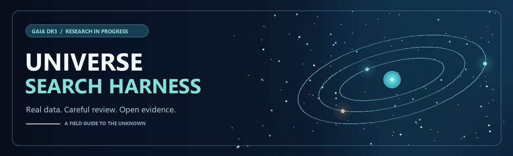
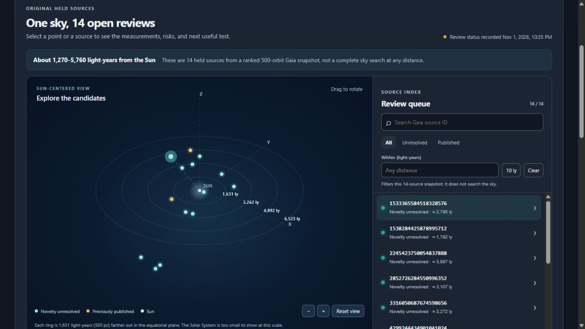

<p align="center">
  
</p>

# Universe Search Harness

Agentic follow-up of Gaia astrometric black-hole candidates, where every agent verdict is checked against the data its tools actually returned.

<p>
  
  
  
  
</p>

> [!IMPORTANT]
> No new black hole is claimed. The agent cannot output a discovery verdict; its best possible outcome is "needs follow-up".

> [!NOTE]
> **Gaia DR4 is scheduled for 2 December 2026.** It is the first Gaia release with epoch astrometry, so held candidates can be refit instead of only triaged. The repository is ready for it: see [Gaia DR4](#gaia-dr4-2-december-2026) and the [release-day runbook](harness/docs/DR4.md).

## The problem

Gaia DR3 published about 170,000 astrometric binary orbits. A few of them have photocentre orbits large enough to imply a dark companion of several solar masses. Most of those turn out to be bad fits, blended light, luminous companions or triples, or have already been studied. Separating them takes many small lookups across Gaia, SIMBAD, VizieR and the literature. That is good work for an agent, but only if you can tell when the agent is making things up.

## What this repo does

1. Triage pipeline (`harness2-universe run`). Reads Gaia DR3 two-body orbits, computes the photocentre mass function f_phot = (a0/parallax)^3 / P^2, excludes known objects, and holds anomalies for review. The bundled 500-row snapshot reproduces exactly: 17 anomalies, 14 held, 2 known black holes and 1 refuted candidate excluded, 0 released.

2. Follow-up agent (`harness2-agent investigate`). A tool-using LLM investigates one candidate at a time with six read-only tools: `nss_orbit`, `gaia_quality`, `simbad_lookup`, `vizier_crossmatch`, `known_catalogs`, `ads_search`. It finishes by submitting a structured verdict in which every claim cites `(call_id, field, value)`.

3. Verifier. The verifier rejects any citation that does not match the tool output, and applies rules per verdict. For example, `PUBLISHED_PRIOR` must cite a real `matched=true` result. Rejected verdicts become `UNVERIFIED`, so a model cannot score by inventing evidence.

4. Blind controls and an outer loop (`harness2-agent eval`, `optimize`). There are 42 sources in the snapshot that are already published: Gaia BH1 and BH2, Shahaf 2023 and Li 2026 candidates. Each control's labeling catalog is withheld, so the agent has to rediscover it through other routes. The harness2 Propose/Probe/Compose loop then tunes the agent's playbook (strategy text, tool order, call budget) on the tune split. A playbook is adopted only on strict improvement, and the test split can be spent once.

5. Whole-catalogue survey with built-in vetting (`harness2-survey`). Takes all 443,205 Gaia DR3 orbit solutions from ESA's bulk file, searches them through an astrometric and a spectroscopic channel with vectorized NumPy or PyTorch kernels, and runs about 20 adversarial tests on every shortlisted source as candidates accumulate. See [`harness/docs/SURVEY.md`](harness/docs/SURVEY.md).

## Why it works for agentic loops

| Need | How it is handled |
| --- | --- |
| A reward that can't be gamed | Evidence-bound verdicts, checked mechanically. Always answering "published" scores zero. |
| Labels the agent hasn't seen | Blind positive controls with the labeling source withheld; a one-shot test-split ledger |
| Bounded cost | Per-candidate limits on steps, tool calls and tokens; compact tool output; shared cache |
| Free reruns | `--tools record` saves every archive response as a fixture; `--tools replay` reruns offline at zero network cost |
| Any model | OpenAI-compatible (OpenRouter, vLLM, llama.cpp, Ollama, LM Studio), Anthropic, plus a deterministic heuristic baseline |
| Safe by default | The model never writes queries or URLs. Arguments are validated against allowlists, nothing is executed, remote endpoints need explicit opt-in, and guarded code is hash-sealed. |

## Quick start

Python 3.11 or newer.

```sh
cd harness
python -m venv .venv
source .venv/bin/activate          # Windows: .venv\Scripts\activate
pip install -r requirements.lock
pip install --no-build-isolation --no-deps -e .

harness2-universe verify
python -m unittest discover -s tests          # 106 tests, offline
harness2-universe run --output runs/base --memory runs/base-memory.json
```

### Run the agent

The archives are public and need no keys. Record live responses once, then replay them as often as you like.

```sh
# Deterministic baseline, no model, records fixtures as it goes
harness2-agent eval --run runs/base --provider heuristic --tools record --fixtures fixtures/live --out runs/eval-heuristic

# Local model (any OpenAI-compatible server on loopback)
harness2-agent eval --run runs/base --provider openai --base-url http://127.0.0.1:8080/v1 --model qwen3 \
    --tools replay --fixtures fixtures/live --out runs/eval-local

# OpenRouter or Anthropic (opt in to remote; only prompts and public archive data are sent)
export OPENROUTER_API_KEY=...
harness2-agent eval --run runs/base --provider openrouter --model YOUR_OPENROUTER_MODEL_ID \
    --allow-remote-model --tools replay --fixtures fixtures/live --out runs/eval-or

# Tune the playbook on the tune split, then spend the test split once
harness2-agent optimize --run runs/base --rounds 4 --proposer llm --provider anthropic \
    --model claude-sonnet-5-5 --allow-remote-model --memory runs/playbook.json --out runs/opt
harness2-agent eval --run runs/base --split test --final --playbook runs/playbook.json --provider anthropic \
    --model claude-sonnet-5-5 --allow-remote-model

# Investigate the 14 held candidates with the tuned playbook
harness2-agent investigate --run runs/base --held --playbook runs/playbook.json --provider anthropic \
    --model claude-sonnet-5-5 --allow-remote-model --tools record --fixtures fixtures/live --out runs/held14
```

Add `--ads` with `ADS_API_TOKEN` set to enable full-text literature search. Without ADS, the two Li 2026 controls can't be rediscovered. That is intentional: it measures what the toolset can and can't find.

Each investigation writes a JSON file with the full transcript, every tool call with provenance, token usage and the verifier's result. `summary.json` reports recall on controls, verified rate, citation failure rate, and mean tool calls and tokens per candidate.

## Results so far

The DR3 review from October and November 2026 is preserved in [`archive/dr3-review-2026-11`](archive/dr3-review-2026-11/README.md). Of the 14 held sources, two turned out to be already-published compact-binary candidates in [Li et al. 2026](https://arxiv.org/abs/2610.34715). A general web-search index failed to find known positive controls during that review. That failure is why this repo now measures agents on blind controls instead of trusting their literature searches.

The first whole-catalogue survey (November 2026) is in [`harness/runs/survey-dr3-20261112`](harness/runs/survey-dr3-20261112/REVIEW.md). It scanned 350,756 solutions and shortlisted 1,547. Vetting excluded 270 as already published, failed 1,001 and left 276 held with caveats. None survived every test, and none is claimed as new.

The [interactive explorer](dashboard/README.md) shows the 14 held sources in 3D with their measurements, risks and references.

<p align="center"></p>

## Limitations

- Controls are positives only. Recall measures whether the agent finds prior work. Nothing here measures discovery precision, because no labeled true negatives exist.
- The bundled snapshot lacks correlation vectors, so Monte Carlo uncertainty is unavailable for all 500 rows. Live runs fetch `corr_vec`.
- Live tool queries (Gaia `gaia_source` columns, SIMBAD `has_ref`/`ref` joins, VizieR tables) were written against the published schemas but have not yet run from this repository's CI. Run one `--tools record` pass and check the fixtures before relying on them.
- The heuristic thresholds (RUWE, IPD, significance) are triage defaults, not validated physical cuts.

## Gaia DR4 (2 December 2026)

ESA has scheduled Gaia DR4 for Wednesday 2 December 2026. It covers 66 months of observations, against 34 for DR3, and it is the first release to publish epoch data: per-transit astrometry, photometry and spectroscopy. For this project, that means refitting orbits from the measurements instead of triaging one catalog solution per source.

What DR4 should make possible:

- Independent orbit refits from epoch astrometry
- Direct tests of the alternatives that keep sources on hold: bad fits, blends, luminous companions and triples
- New controls from DR3 candidates that DR4 confirms or refutes, giving the first labeled negatives
- The strongest test yet of the 14 held sources. A DR4 orbit that stays anomalous is still a held anomaly for human review, not a discovery.

Ready in the repository now:

| Item | What it does |
| --- | --- |
| [`dr4_readiness.py`](harness/scripts/dr4_readiness.py) | `check --release gaiadr4` compares the archive schema with every table and column the harness queries, lists candidate epoch and DR3-to-DR4 match tables, and checks sampled NSS covariance layouts against the parser |
| [`watchlist.csv`](harness/data/dr4/watchlist.csv) | The 54 sources to pull first: 14 held and 42 controls, 2 of them in both groups |
| [`dr4-watch.yml`](.github/workflows/dr4-watch.yml) | Checks the archive daily, runs DR3 as a positive control, and fails when DR4 appears with a schema the harness can't read unchanged |
| [`DR4.md`](harness/docs/DR4.md) | Every DR3 assumption in the code, and the release-day runbook |

```sh
cd harness
python scripts/dr4_readiness.py check --release gaiadr4 --out runs/dr4-readiness.json
```

The harness still runs on DR3. Switching releases changes guarded code, so it will happen in a reviewed PR after the schema check, never by assumption. Gaia source IDs can change between releases, so DR3 IDs will be mapped through the official cross-release table before any comparison.

## Layout

| Path | Contents |
| --- | --- |
| [`harness/`](harness/README.md) | Python package: pipeline, agent, verifier, controls, tests |
| [`harness/harness2/agent/`](harness/harness2/agent) | `tools.py`, `models.py`, `loop.py`, `verify.py`, `evaluate.py` |
| [`harness/data/controls/`](harness/data/controls/controls_v1.json) | 42 labeled controls with a fixed tune/test split |
| [`harness/harness2/survey/`](harness/harness2/survey) | Bulk acquisition, vectorized search, vetting battery (new, awaiting review and seal) |
| [`harness/docs/DR4.md`](harness/docs/DR4.md) | Gaia DR4 readiness: DR3 assumptions and the release-day runbook |
| [`dashboard/`](dashboard/README.md) | Static 3D explorer for the held sources |
| [`archive/dr3-review-2026-11/`](archive/dr3-review-2026-11/README.md) | Frozen evidence packet from the first review |
| [`AGENTS.md`](AGENTS.md) | Rules for coding agents working in this repo |

## Attribution

The code is Apache-2.0. Gaia data are from ESA/Gaia/DPAC. Third-party papers, catalogs and survey products keep their own terms; see [third-party notices](archive/dr3-review-2026-11/public-review/THIRD_PARTY_NOTICES.md). Some included source archives are CC BY-NC-SA 4.0.
